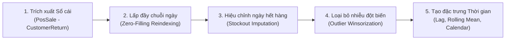

# 🧹 Sales Data Preparation & Feature Engineering - POS PWA Project

Tài liệu này quy định quy trình **Trích xuất, Làm sạch và Kỹ thuật Đặc trưng Chuỗi thời gian (Time-Series ETL & Feature Engineering)** từ dữ liệu bán hàng thực tế của hệ thống **POS PWA (Point of Sale Progressive Web App)**. Chất lượng của mô hình dự báo phụ thuộc trực tiếp vào độ sạch của dữ liệu đầu vào: dữ liệu thô từ máy POS thường bị khuyết những ngày cửa hàng đóng cửa, nhiễu do đơn hàng hoàn trả, hoặc bị méo mó vào những ngày sản phẩm hết hàng sớm (**Stockout Censorship**).

---

## 🔄 1. Quy trình Tiền xử lý Dữ liệu 5 Bước (Data Preprocessing Pipeline)



### 1.1. Bước 1: Tính Nhu cầu Thực bán Ròng (`Net Daily Demand`)
Tổng hợp từ bảng `inventory_transactions` (chỉ lấy các đơn `Completed`, loại bỏ đơn `Cancelled` và đơn `Refunded`):

$$\text{NetDemand}_{p, t} = \sum_{i \in \text{PosSale}(p, t)} |Q_i| - \sum_{j \in \text{CustomerReturn}(p, t)} Q_j$$

### 1.2. Bước 2: Lấp đầy Chuỗi Thời gian Liên tục (`Zero-Filling`)
Nếu sản phẩm $p$ không phát sinh giao dịch nào vào ngày $t$ trong khi cửa hàng vẫn mở bán bình thường (có ít nhất 1 đơn hàng của các sản phẩm khác trong ngày $t$), hệ thống chèn bản ghi $\text{NetDemand}_{p, t} = 0$ để chuỗi thời gian không bị đứt gãy ngày.

### 1.3. Bước 3: Hiệu chỉnh Nhu cầu bị Cắt xén do Hết hàng (`Stockout Imputation`)
**Bài toán:** Vào ngày thứ Ba, sản phẩm *Bánh mì que* chỉ còn tồn `3` cái và bán hết sạch vào lúc `08:30 sáng`. Sổ cái ghi nhận cả ngày chỉ bán được `3` cái, nhưng thực tế nhu cầu của khách lớn hơn nhiều.
* **Cách nhận diện:** Kiểm tra bản ghi cuối cùng của sản phẩm $p$ trong ngày $t$ trên `inventory_transactions` có `balance_after == 0` trước giờ đóng cửa cửa hàng (`18:00`).
* **Cách hiệu chỉnh:** Thay thế giá trị bị cắt xén đó bằng trung bình động có trọng số của cùng thứ trong tuần (ví dụ: trung bình các ngày thứ Ba gần nhất còn đủ hàng) để mô hình AI không hiểu nhầm rằng nhu cầu đang sụt giảm.

---

## ⚙️ 2. Bộ Đặc trưng Đầu vào (`Feature Engineering Matrix`)

Đối với các mô hình học máy dạng bảng (**LightGBM / XGBoost**), mỗi cặp `(ProductId, Date)` được biến đổi thành vector đặc trưng chuẩn hóa:

| Nhóm đặc trưng | Tên cột đặc trưng (`Feature`) | Công thức / Ý nghĩa nghiệp vụ |
| :--- | :--- | :--- |
| **Đặc trưng Lịch & Mùa vụ (`Calendar Features`)** | `day_of_week` (`0–6`), `is_weekend`, `day_of_month`, `is_payday` (ngày `5, 10, 15, 25, 30`), `is_public_holiday` | Nắm bắt chu kỳ tăng vọt doanh số vào cuối tuần (Thứ 6 – Chủ Nhật), ngày nhận lương và các dịp Lễ/Tết tại Việt Nam. |
| **Đặc trưng Trễ (`Lag Features`)** | `lag_1`, `lag_2`, `lag_7`, `lag_14` | Doanh số của ngày hôm qua, hôm kia, cùng ngày tuần trước và 2 tuần trước. |
| **Thống kê Trượt (`Rolling Window`)** | `rolling_mean_7d`, `rolling_std_7d`, `rolling_mean_28d`, `ema_7d` (Trung bình lũy thừa) | Phản ánh xu hướng tăng trưởng hoặc suy giảm gần đây của sản phẩm. |
| **Đặc trưng Giá & Khuyến mãi** | `current_price`, `discount_ratio` | Phát hiện tác động của việc tăng/giảm giá bán tới sức mua của khách hàng. |

---

## 💻 3. Truy vấn SQL Tổng hợp Dữ liệu Huấn luyện Tối ưu (PostgreSQL 16)

```sql
WITH daily_store_activity AS (
    -- Xác định những ngày cửa hàng thực sự mở cửa hoạt động
    SELECT DISTINCT tenant_id, DATE(created_at AT TIME ZONE 'Asia/Ho_Chi_Minh') AS sale_date
    FROM orders
    WHERE tenant_id = @TenantId AND status = 'Completed'
      AND created_at >= NOW() - INTERVAL '180 days'
),
daily_product_sales AS (
    SELECT
        it.product_id,
        DATE(it.created_at AT TIME ZONE 'Asia/Ho_Chi_Minh') AS sale_date,
        SUM(CASE WHEN it.transaction_type = 'PosSale' THEN ABS(it.quantity_delta)
                 WHEN it.transaction_type = 'CustomerReturn' THEN -it.quantity_delta
                 ELSE 0 END) AS net_sold_qty,
        MIN(it.balance_after) AS min_eod_stock
    FROM inventory_transactions it
    WHERE it.tenant_id = @TenantId
      AND it.created_at >= NOW() - INTERVAL '180 days'
    GROUP BY it.product_id, DATE(it.created_at AT TIME ZONE 'Asia/Ho_Chi_Minh')
)
SELECT
    p.id AS product_id,
    dsa.sale_date,
    COALESCE(dps.net_sold_qty, 0) AS demand_qty,
    CASE WHEN COALESCE(dps.min_eod_stock, p.stock_quantity) = 0 THEN true ELSE false END AS had_stockout
FROM products p
CROSS JOIN daily_store_activity dsa
LEFT JOIN daily_product_sales dps
    ON dps.product_id = p.id AND dps.sale_date = dsa.sale_date
WHERE p.tenant_id = @TenantId AND p.is_active = true
ORDER BY p.id, dsa.sale_date;
```

---
